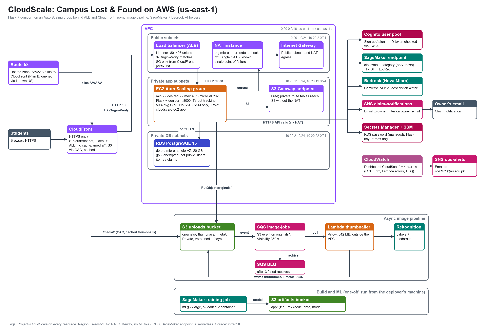

# CloudScale: Campus Lost & Found on AWS

CS-4075 Cloud Computing semester project, FAST-NUCES Islamabad (Instructor: Dr. Basharat Hussain).
Team: Awwab Aamir (22i-0971), Rayyan Khan (22i-1002). Region: `us-east-1`.

Students sign up, post lost or found items with a photo, search, and claim items. The owner gets an
email when their item is claimed. Photos are thumbnailed, tagged and moderated in the background, and
two AI helpers fill in the post form: a category suggester (our own SageMaker model) and a
description writer (Amazon Bedrock).



## Stack at a glance

| Layer | What we use |
|---|---|
| Web app | Python 3.12, Flask, gunicorn, Jinja templates (no SPA), boto3, psycopg 3 |
| Compute | EC2 Auto Scaling group (min 2 / desired 2 / max 4, `t3.micro`, Amazon Linux 2023) in private subnets behind an ALB |
| Edge | CloudFront (HTTPS, default behaviour to ALB, `/media/*` to S3 through OAC) |
| Data | RDS PostgreSQL 16 (`db.t4g.micro`, single-AZ, private), S3 (uploads, artifacts) |
| Async | S3 event, SQS `image-jobs` (+ DLQ), Lambda thumbnailer, Rekognition labels and moderation |
| Messaging | SNS `claim-notifications` (owner emails), SNS `ops-alerts` (alarms) |
| Identity | Cognito user pool (email sign-up, server-side auth), least-privilege IAM roles |
| AI/ML | SageMaker training job and **serverless** endpoint, Bedrock Converse (Nova Micro) |
| Ops | CloudWatch dashboard and four alarms, Route 53 hosted zone, AWS Budget |
| IaC | Terraform (`hashicorp/aws ~> 5`), local state |

## Repository layout

```
infra/      Terraform: network, security, storage, database, identity, compute, cdn,
            serverless, messaging, ml, monitoring, dns, user_data.sh.tpl
app/        Flask app: app.py config.py db.py auth.py aws_clients.py seed_db.py, migrations/, templates/, static/
lambda/     thumbnailer/handler.py (Pillow + Rekognition)
ml/         make_seed.py, data/seed_listings.csv, train.py, launch_training.py, deploy_endpoint.py, delete_endpoint.py
scripts/    package_app.ps1  build_lambda.ps1  load_test.py  teardown.ps1
docs/       aidlc/ (one file per phase), iam-justification.md, architecture.png, screenshots/, report/
AI-DLC-LOG.md   one entry per bolt (Inception, Construction with human review, Operations)
CLAUDE.md       project brief given to the AI assistant
```

## How this was built (AI-DLC)

Every phase ("bolt") followed Inception, Construction, Operations. The assistant wrote an inception
document (`docs/aidlc/phase-*.md`), proposed a Terraform plan, and **nothing was applied to AWS until
the human (Awwab) approved the plan**. The approvals, the problems found along the way (Free-plan
instance restriction, SageMaker quota, zip path separators, ASG service-linked-role delay) and the
fixes are recorded in each phase document and in [AI-DLC-LOG.md](AI-DLC-LOG.md). The incremental
commit history (`phase-N(inception|construction|operations): ...`) is the process evidence.

## Prerequisites

- Windows with PowerShell, Python 3.12, Terraform >= 1.6, AWS CLI v2, Git.
- An AWS account with an IAM user for deployment (`aws configure`). **Never put access keys in files or Git.**
- `pip install boto3 pillow httpx` (for the ML scripts, seed generator and load test).

## Deploy from scratch

All commands run from the repository root. The order matters because the instances download the app
zip from the artifacts bucket when they boot.

```powershell
# 1. Build the Lambda package (Linux wheels for Pillow) and initialise Terraform
.\scripts\build_lambda.ps1
cd infra
terraform init

# 2. Create the artifacts bucket first, then upload the app zip (version must match var.app_version)
terraform apply -target=aws_s3_bucket.artifacts
cd ..
.\scripts\package_app.ps1 -Version 1.2.0

# 3. Review the plan, then apply everything (~15 minutes: RDS, ALB and CloudFront are slow)
cd infra
terraform plan -out tfplan
terraform apply tfplan
```

Then the ML part (needs the `cloudscale-sagemaker-exec` role from step 3):

```powershell
python ml\launch_training.py ml.g5.xlarge        # trains in SageMaker; prints JOB_NAME=...
python ml\deploy_endpoint.py <JOB_NAME>          # creates the serverless endpoint 'cloudscale-category'
```

> A brand-new AWS account may have quota 0 for `ml.m5.large` training. `ml.g5.xlarge` worked for us
> (about $0.02 for the job). The sklearn container is CPU-only and runs fine on it.

Optional demo data (the database is private, so run it on an app instance through Session Manager):

```powershell
$id = aws autoscaling describe-auto-scaling-groups --auto-scaling-group-names cloudscale-asg --query "AutoScalingGroups[0].Instances[0].InstanceId" --output text
aws ssm send-command --instance-ids $id --document-name AWS-RunShellScript --parameters 'commands=["cd /opt/cloudscale/app && sudo -u cloudscale env $(cat /etc/cloudscale.env | xargs) /opt/cloudscale/venv/bin/python seed_db.py"]'
```

Open the site at `terraform output cloudfront_domain` (`https://<id>.cloudfront.net`).
Confirm the `ops-alerts` email subscription (AWS sends a confirmation link to the alert address).

## Releasing a new app version

1. `.\scripts\package_app.ps1 -Version X.Y.Z`
2. Set `app_version` to `X.Y.Z` in `infra/variables.tf`, then `terraform plan` / `terraform apply`.
   The launch template changes, and the ASG replaces instances in a rolling instance refresh
   (at least 50% stay healthy, so the site stays up).

## Load test and failure test

```powershell
aws ssm put-parameter --name /cloudscale/enable-stress --value true --overwrite --type String
python scripts\load_test.py --url https://<cloudfront-domain> --concurrency 40 --duration 840 --ms 300
aws ssm put-parameter --name /cloudscale/enable-stress --value false --overwrite --type String
```

CPU stays near 98%, target tracking scales the group from 2 to 4 instances, and the
`cloudscale-asg-cpu-high` alarm emails `ops-alerts`. For the failure test, terminate one instance
(`aws ec2 terminate-instances --instance-ids <id>`) while requesting the site: the ALB stops routing
to it and the ASG launches a replacement (results in `docs/aidlc/phase-8-monitoring-dns.md`).

## Teardown (after grading)

```powershell
.\scripts\teardown.ps1
```

It asks you to type `destroy`, deletes the SageMaker endpoint, configs and models, runs
`terraform destroy` (buckets use `force_destroy`), removes SageMaker log groups and lists anything
billable that is left. It deliberately **does not** touch the AWS Budget, billing settings or the
deployer IAM user: delete the deployer's access keys yourself afterwards and take the cleanup
screenshot.

## Security notes

- No `AdministratorAccess` anywhere; every role is scoped to specific ARNs. The only `Resource: "*"`
  statements are for APIs without resource-level permissions (Rekognition, `ecr:GetAuthorizationToken`,
  `kms:Decrypt` limited to calls through SSM). Each is explained in [docs/iam-justification.md](docs/iam-justification.md).
- No secrets in Git: the RDS password is generated and held by RDS in Secrets Manager, the Flask key is an
  SSM SecureString, and `.gitignore` covers state files, `*.tfvars`, `.env*`, keys and build output.
- Instances have no public IPs and no SSH (Session Manager only); the ALB accepts traffic only from CloudFront
  and only with a secret header; the database accepts only the app security group.

## Known limitations (honest notes for the report)

- **Single NAT instance** is a single point of failure (cost decision; no NAT Gateway).
- **Route 53 Plan B:** we could not get a free delegated domain, so the hosted zone is not reachable through public DNS; resolution is shown by querying its own name servers.
- **ML data is synthetic** (template-generated), so the 98.75% hold-out accuracy is optimistic.
- Losing an instance causes a short blip (about 25 seconds in our test) before the ALB stops sending traffic to it.
- Minimal CSRF protection (SameSite=Lax session cookie, JSON-only API endpoints).
